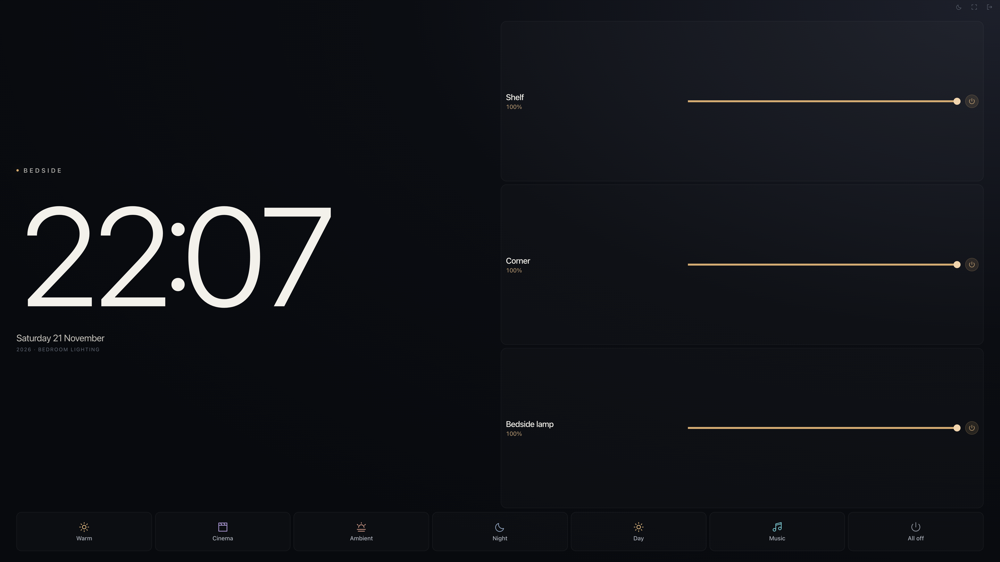

# Home Assistant bedroom lighting

A bedroom lighting setup I built around Home Assistant, running on a Linux mini PC. It brings two WLED LED strips and a Xiaomi bedside lamp into one system, with one-tap scenes and a custom touchscreen dashboard on an Android phone.

## What it does

- **Seven scenes** (Day, Warm, Cinema, Ambient, Night, Music, All off), each a Home Assistant script that sets both strips and the lamp together
- **Custom dashboard card** (`bedside-console.js`): a full-screen bedside display with a clock, brightness sliders for each light and the scene buttons. It dims to a large low-brightness clock between 23:00 and 07:00 when the lights are off, and moves slightly every few minutes to reduce OLED burn-in
- **Phone brightness automation**: sets the screen brightness by time of day, and drops it to minimum overnight or when the strips are off
- **Music mode**: the strips follow whatever the Mac is playing, using LedFx and a BlackHole virtual audio device. The Music button in Home Assistant switches the strips over to the live LedFx stream, and every other scene switches them back

## How it fits together

```
Android phone (dashboard)  -->  Home Assistant (mini PC)  -->  WLED strips + Xiaomi lamp
                                                                  ^
Mac audio -> BlackHole -> LedFx ----------- live stream (DDP) ----+
```

Each scene script first switches the strips' "live override" off, so LedFx can't overwrite the colours, then applies the colours and brightness. The Music script does the reverse.



## Hardware

- Linux mini PC running Home Assistant
- Two WLED strips: corner (214 LEDs) and shelf (140 LEDs), both RGBW
- Xiaomi bedside lamp
- Pixel 7 as the bedside display, running the Home Assistant app or Fully Kiosk
- MacBook running LedFx for music mode

## Files

| Path | What it is |
|---|---|
| `home-assistant/scripts.yaml` | The seven scene scripts |
| `home-assistant/bedside-dashboard.yaml` | Dashboard config that loads the custom card |
| `home-assistant/www/bedside-console.js` | The custom dashboard card (plain JavaScript, no dependencies) |
| `home-assistant/automations.yaml` | Phone screen brightness automation |
| `ledfx/config.json` | LedFx configuration for the two strips |
| `ledfx/start-ledfx.command` | Mac launcher for LedFx |
| `docs/SETUP.md` | Step-by-step setup notes |

## Using these files

Everything personal has been replaced with `YOUR_...` placeholders (entity IDs, IP addresses, device IDs). Find your own entity IDs under Developer Tools > States in Home Assistant and swap them in. `docs/SETUP.md` has the full steps.

## Notes

- The dashboard card and scripts were written with help from ChatGPT, then tested on my own setup.
- Not included yet: a prototype that wakes the phone screen on motion.
